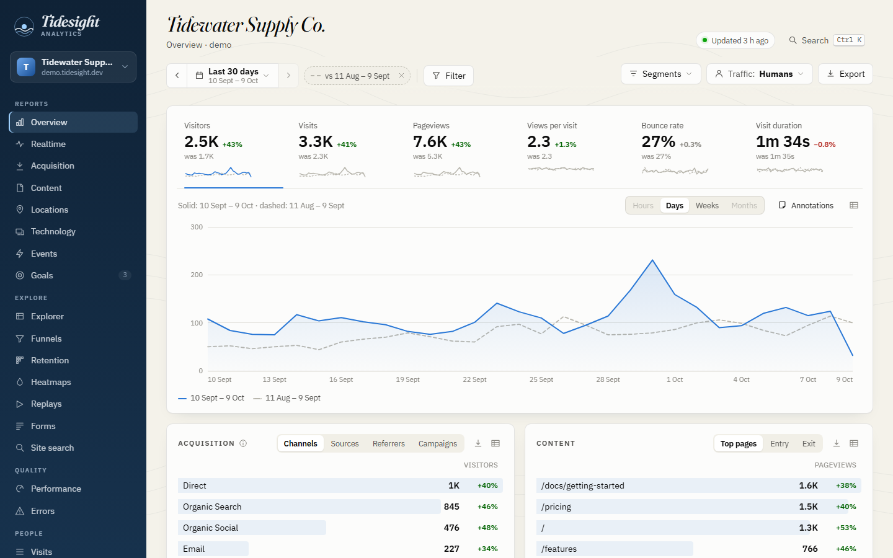
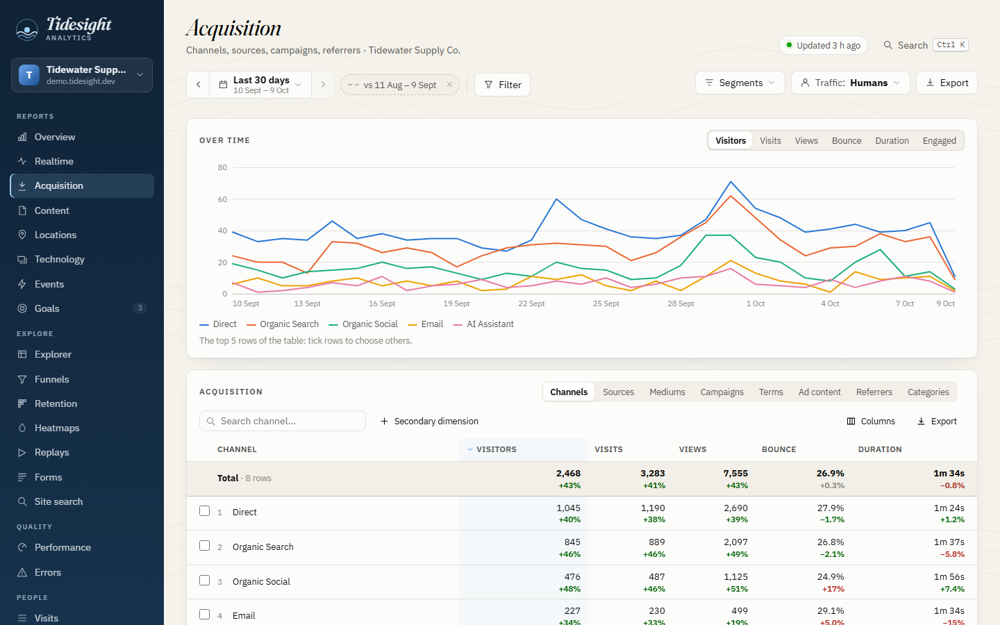
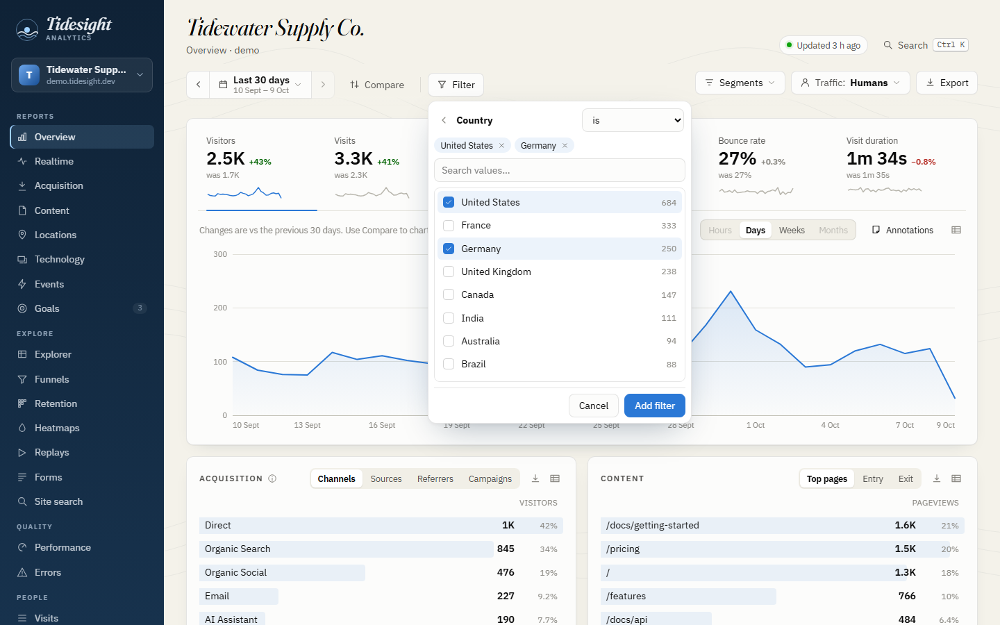
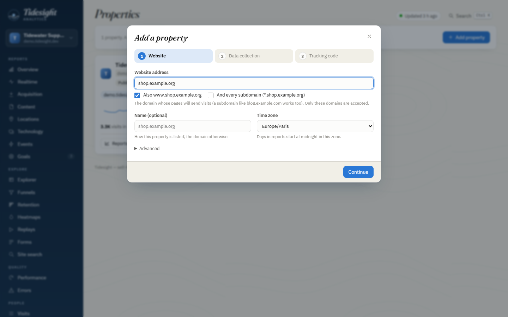
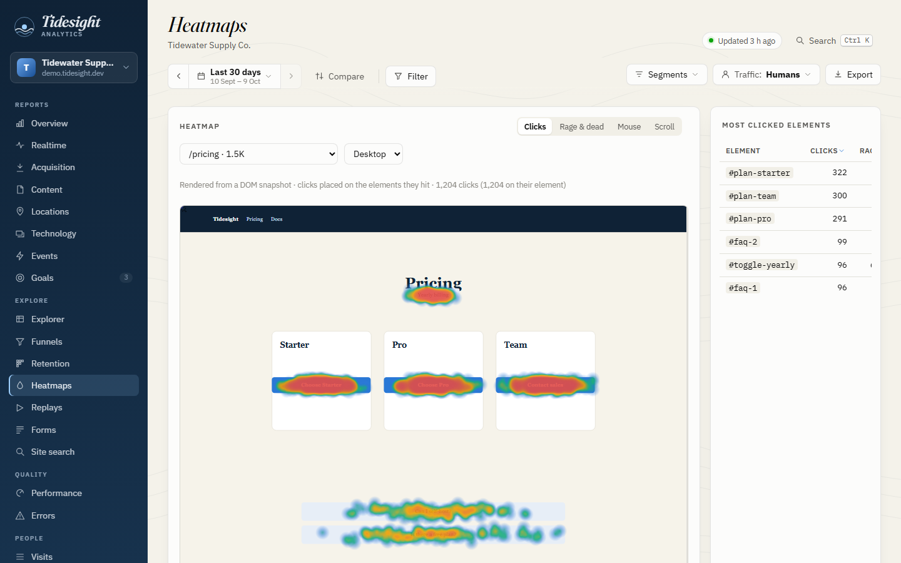
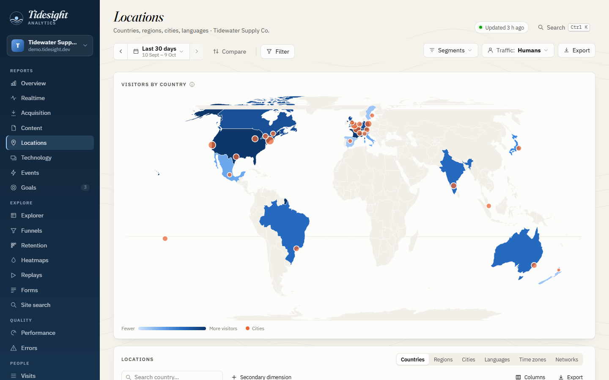
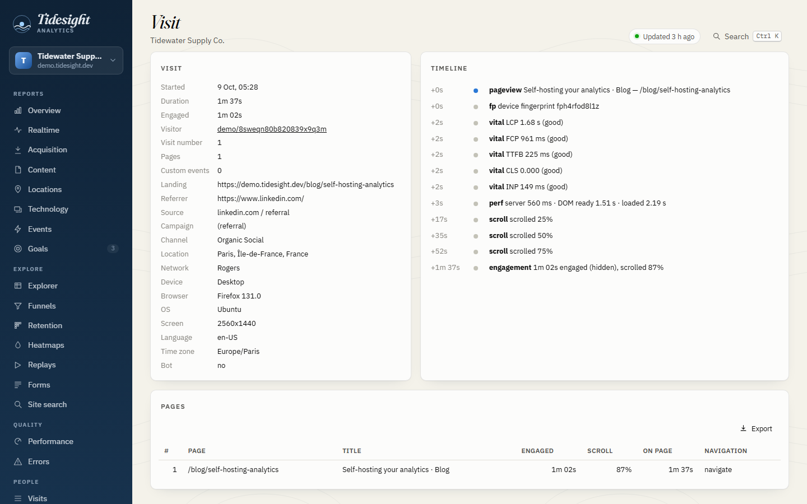

# Tidesight

Self-hosted web analytics that keeps every raw hit. Traffic ebbs and flows like a tide; *sight* is the insight you get from watching it.

<picture>
  <source media="(prefers-color-scheme: dark)" srcset="docs/images/overview-dark.png">
  
</picture>

- **Collect** with a small JavaScript tracker (`ts.js`, about 6 KB gzip) and plugins loaded on demand.
- **Ingest** with a Python collector that uses only the standard library and appends every hit, raw, to SQLite. It runs on cheap shared hosting: Passenger WSGI or CGI, cron, no daemons.
- **Analyse** with re-runnable jobs that derive sessions, geography, devices, bots, channels and visitor identity, and a dashboard on top of a small JSON API.

Tidesight works for any number of sites and is data-rich by default. A privacy mode (IP truncation or hashing, retention windows, DNT/GPC, no fingerprinting) is a configuration change plus a clean-up job.

## What it records

| | |
|---|---|
| **Traffic** | Pageviews with full context (referrer, UTM and click ids, screen, language, time zone, high-entropy Client Hints), SPA route changes (History API and `#hash` routes), custom events with properties, user ids, 404 pages, site search. |
| **Visitors** | A persistent visitor id (first-party cookie + localStorage, optionally a server-set cookie), sessions with idle timeout, engaged time (visible, focused, not idle), new vs returning, identity stitching across devices and ids. |
| **Behaviour** | Clicks with element-relative heatmap positions, rage, dead and error clicks, outbound links and downloads, scroll depth, form analytics (timings and abandonment, never values), mouse movement, copy and selection, ad-blocker detection. |
| **Quality** | Web Vitals (LCP, INP, CLS, FCP, TTFB), Navigation Timing, long tasks, JavaScript and resource errors (de-duplicated). |
| **Replay** | Session recordings with [rrweb](https://github.com/rrweb-io/rrweb) (sampled, passwords never recorded, inputs masked by default) and DOM snapshots that keep heatmaps accurate when layouts change. |
| **Server side** | Raw IP and every request header (credentials and other cookies redacted), the raw payload, receive time and client time. |
| **Derived** | Geolocation (DB-IP Lite, MaxMind GeoLite2 or IPinfo Lite, read by a pure-Python reader), browser, OS and device from the user agent and Client Hints, bot classification, GA4 channel grouping (including AI assistants), a cookieless daily visitor hash, daily rollups. |

Every family of data points and every heavy feature has a per-site switch, and behaviour plugins have a per-site sampling rate. The full catalogue is in [`docs/datapoints.md`](docs/datapoints.md).

## The dashboard

Overview, realtime, acquisition (channels, sources, mediums, campaigns, referrers), content (pages, entry and exit pages, titles, error pages), locations, technology, events and their properties, goals and conversions, an explorer for any dimension, funnels, retention cohorts, heatmaps (clicks, rage and dead clicks, mouse, scroll reach), replays, forms, site search, Web Vitals, errors, visits with a timeline, visitor profiles, properties and a status page.

- **Analysis as in the big tools:** compare any period with the previous one, the same days a year before or any range (dashed in charts, changes everywhere); filter every report by any dimension with `is`, `is not`, `contains`, `does not contain`, `starts with`, or with a click on a row; save filters as segments; mark days with annotations; set goals and see their conversions in every report.
- **Report tables** with server-side sort, search and paging, totals and shares, a second dimension, a column chooser, row actions, up to five rows plotted over time, and every matching row exported to Excel, CSV, TSV or JSON. An export dialog says exactly what each download holds, raw datasets included.
- **Properties managed in the dashboard:** add a site (domains, name, time zone, what to record) and get its tracking code with a live check of the first hit; change its settings, goals, privacy and public page; delete it with or without its data. A property is shown by its name, else by its most precise domain.
- Sign-in page, a command palette (Ctrl/⌘ K) and keyboard shortcuts, a freshness indicator, light and dark themes, a table twin for every chart, optional public share pages. Everything it shows comes from a [JSON API](docs/api.md) that scripts can use too.

<table>
  <tr>
    <td width="33%"></td>
    <td width="33%"></td>
    <td width="33%"></td>
  </tr>
  <tr>
    <td align="center">Reports and comparisons</td>
    <td align="center">Filters</td>
    <td align="center">Properties</td>
  </tr>
  <tr>
    <td width="33%"></td>
    <td width="33%"></td>
    <td width="33%"></td>
  </tr>
  <tr>
    <td align="center">Heatmaps</td>
    <td align="center">Locations</td>
    <td align="center">Visit timeline</td>
  </tr>
</table>

## Try it locally

Requires Python 3.9 or later and nothing else.

```sh
python tools/demo.py --out demo-data
python server/python/devserver.py --config demo-data/tidesight.toml --no-auth --port 8790
```

Then open <http://127.0.0.1:8790/dashboard/>. The demo sends 60 days of synthetic traffic from about 4,000 visitors through the real collector and enrichment jobs (pages, campaigns, purchases, errors, recordings, a few bots), which takes about half a minute. `--no-auth` skips the dashboard password; use it only locally.

## Add the tracker to a site

```html
<script async src="https://stats.example.com/ts.js" data-site="example"></script>
```

```js
tidesight('track', 'signup', { plan: 'pro' });   // custom event
tidesight('identify', 'user-42');                 // known user
tidesight('ignore');                              // run once in your own browser to exclude it
```

Every command, the page markup (error pages, masking, elements to leave out), single-page apps, Content Security Policy and the no-JavaScript pixel are covered in [`docs/tracker.md`](docs/tracker.md); switching features per site, in [`docs/configuration.md`](docs/configuration.md).

## Deploy

On Dreamhost or any host with Passenger (or plain CGI) and cron, follow [`docs/deploy-dreamhost.md`](docs/deploy-dreamhost.md): check the host with `tools/sqlite_host_test.py`, copy and edit [`config/tidesight.example.toml`](config/tidesight.example.toml), install `passenger_wsgi.py`, and add the cron lines. Updates are a `git pull`: database migrations run automatically, and when the way data is derived changes, the next enrichment rebuilds it from the raw hits.

A host that runs PHP but not Python web apps can ingest with the [PHP connector](server/php/README.md) and keep Python for the cron jobs only; [Node](server/node/README.md) and [Cloudflare Workers](server/worker/README.md) work too.

## How it works

```
 browser ── ts.js + plugins ──▶ collector (/collect, /chunk, /p.gif)
                                   │  appends raw, flags anything odd, never enriches
                                   ▼
                          events.db  (raw hits)        replay.db  (recordings, mouse, snapshots)
                                   │
                cron: jobs.py enrich, rollup, backup, privacy-clean, …
                                   ▼
                          derived.db  (sessions, pageviews, geo, devices, bots, identity, rollups)
                                   │
                         api.py (JSON) ──▶ dashboard (static, no build step)
```

`derived.db` can be deleted at any time: it is rebuilt from the raw data. Details in [`docs/architecture.md`](docs/architecture.md), and the reasoning behind each choice in [`docs/design.md`](docs/design.md).

Besides the Python collector, connectors for **PHP**, **Node** and **Cloudflare Workers (D1)** speak the same protocol and write the same schema, checked by a shared conformance suite ([`docs/connectors.md`](docs/connectors.md)).

## Security and abuse protection

- **The collector is a public endpoint, so it is bounded:** body sizes and gzip expansion are capped. Each client (an IPv4 address or an IPv6 /64) has per-minute allowances for requests and kilobytes, with separate allowances for recordings. Once a client is over its allowance, its requests are refused before their body is even parsed. Junk traffic (unknown sites, wrong origins, malformed bodies) gets its own small allowance, so it cannot crowd out real data. An optional daily quota per site caps storage, and writes stop with a 503 when disk space runs low. Refusals are counted on the Status page ([details](docs/configuration.md#limits-and-abuse-protection)).
- **The tracker cannot flood it either:** it caps its own events and uploads per minute, splits batches under the collector's size limit, and backs off on errors. It also trusts nothing on the host page: markup injected into a page cannot redirect it or make it load another script.
- **No secrets are stored:** credentials and other sites' cookies are redacted from headers. Tokens, passwords, session ids and signatures in URLs are replaced by `redacted` before they leave the browser (and in the `Referer` the collector keeps). Form values are never collected, and session replays mask inputs and rich-text editors.
- **The dashboard is protected:** people sign in with a form (PBKDF2 hashes, throttled guessing, an HttpOnly `SameSite=Strict` session cookie whose token is stored only as a hash and ends when the password changes); scripts may use HTTP Basic. Every change needs the dashboard's own header and origin, and only `[dashboard] admins` change properties. The API bounds the work hostile data can cause, and the pages have a strict Content Security Policy that keeps recordings from contacting other hosts. Public share pages are optional, token-protected, rate-limited, and never show figures for fewer than 3 visitors.
- **Audited:** the collectors, the tracker and the dashboard went through adversarial security reviews, and every finding was fixed and covered by tests (`docs/roadmap.md`).

## Status

Every phase of the plan is built and tested: collector, tracker, enrichment, behaviour plugins, session replay, dashboard and API, privacy mode and maintenance jobs, and the PHP, Node and Worker connectors. The hosting test passed on the production Dreamhost account (SQLite with WAL). Still open: the first deployment, and trying the PHP and Worker connectors on live hosts. See [`docs/roadmap.md`](docs/roadmap.md).

## Development

| Task | Command |
|---|---|
| Python tests | `python -m pytest` |
| Tracker build and browser tests | `cd tracker && npm install && npx playwright install chromium && npm test` |
| Dashboard browser tests | `cd tracker && npm run test:dashboard` (demo data, two local servers) |
| Connector conformance | `TIDESIGHT_CONNECTORS=php python -m pytest server/python/tests/test_conformance.py` |

Contributors and coding agents: start with [`AGENTS.md`](AGENTS.md).

## Documentation

- [Design principles and decisions](docs/design.md)
- [Architecture](docs/architecture.md)
- [Using the tracker](docs/tracker.md)
- [Dashboard API](docs/api.md)
- [Wire protocol](docs/protocol.md)
- [Database schema](docs/schema.md)
- [Data-point catalogue](docs/datapoints.md)
- [Configuration](docs/configuration.md)
- [Deploying on Dreamhost](docs/deploy-dreamhost.md)
- [Privacy mode and clean-up jobs](docs/privacy.md)
- [Connectors and writing a new one](docs/connectors.md)
- [Roadmap](docs/roadmap.md)

## Licence

MIT, see [`LICENSE`](LICENSE). Vendored third-party code keeps its own licence: rrweb and rrweb-player (MIT), the Fraunces and IBM Plex fonts (SIL OFL 1.1), and country outlines from Natural Earth via world-atlas (ISC). Geolocation databases are downloaded by the `geo-update` job, never bundled; DB-IP Lite data requires attribution (CC BY 4.0), which the dashboard shows.
