<div align="center">


# Tidesight

**Self-hosted web analytics that keeps every raw hit.**<br>
Traffic ebbs and flows like a tide; *sight* is the insight you get from watching it.

[**Live demo**](https://mayerwin.github.io/Tidesight/demo/#/overview?site=demo) · [Website](https://mayerwin.github.io/Tidesight/) · [Get started](#get-started) · [Documentation](#documentation)

[](https://github.com/mayerwin/Tidesight/releases/latest)
[](LICENSE)
[](server/python)
[](https://mayerwin.github.io/Tidesight/demo/#/overview?site=demo)

</div>

<picture>
  <source media="(prefers-color-scheme: dark)" srcset="docs/images/overview-dark.png">
  
</picture>

Tidesight is web analytics you host yourself, for any number of websites. A small tracker sends every pageview, event, click, scroll, Web Vital and error to a collector that stores them **raw**, on your server. Jobs then derive sessions, places, devices, channels, bots and identities, and a dashboard as complete as the big tools shows it all: comparisons, filters, segments, goals, funnels, retention, heatmaps, session replays and visitor timelines.

- **Collect** with a small JavaScript tracker (`ts.js`, about 8 KB gzip) and plugins loaded only where they are switched on.
- **Ingest** with a Python collector that uses only the standard library and appends every hit, raw, to SQLite. It runs on cheap shared hosting: FastCGI or CGI (or Passenger), cron, no daemons.
- **Analyse** with re-runnable jobs, and a dashboard on top of a small JSON API that your scripts can use too.

Data-rich by default, every family of data points has a per-site switch, and a privacy mode (IP truncation or hashing, retention windows, Do Not Track and GPC, no fingerprinting) is a configuration change plus a clean-up job.

## Live demo

**[Open the live demo](https://mayerwin.github.io/Tidesight/demo/#/overview?site=demo)**: Tidesight's own dashboard and Python web app, compiled to WebAssembly ([Pyodide](https://pyodide.org)) and running in your browser, on 60 days of made-up visits to three made-up websites: a surf shop, a magazine and a web app. Look around freely: it is read-only, and nothing leaves your browser. It is rebuilt every six hours, so its dates are always recent (the first visit downloads about 12 MB).

## Get started

### 1. Try it on your computer

Python 3.9 or later, nothing else.

```sh
git clone https://github.com/mayerwin/Tidesight.git && cd Tidesight
python tools/demo.py --out demo-data
python server/python/devserver.py --config demo-data/tidesight.toml --no-auth --port 8790
```

Then open <http://127.0.0.1:8790/dashboard/>. The demo sends 60 days of visits to the three made-up websites through the real collector and enrichment jobs (pages, campaigns, purchases, forms, errors, recordings, a few bots), which takes about a minute. `--no-auth` skips signing in; use it only on your computer.


### 2. Put it on your host

On Dreamhost or any host with Python (FastCGI or CGI) and cron, everything lives in one folder, the website's: the code in `app/`, the data in `data/`, the configuration beside them, behind an `.htaccess` that sends every request to the app. Tidesight checks from the outside, every ten minutes, that none of its files can be downloaded.

```sh
cd ~/stats.example.com        # the website's folder
curl -L https://github.com/mayerwin/Tidesight/releases/latest/download/tidesight.tar.gz | tar xz
cp app/server/python/tidesight.fcgi . && chmod 755 tidesight.fcgi
cp app/server/python/web.htaccess .htaccess
cp app/config/tidesight.example.toml tidesight.toml    # then set public_url, and add the cron lines
```

[**The step-by-step deployment guide**](docs/deploy-dreamhost.md) covers the host check (`tools/sqlite_host_test.py`), HTTPS, the configuration, the cron lines and the firewall. A host that runs PHP but not Python web apps can collect with the [PHP connector](server/php/README.md); [Node](server/node/README.md) and [Cloudflare Workers](server/worker/README.md) work too.

### 3. Create the first account

The first time the dashboard opens, it asks for a setup code that Tidesight wrote on the server, so that a bot finding a new installation first cannot claim it.

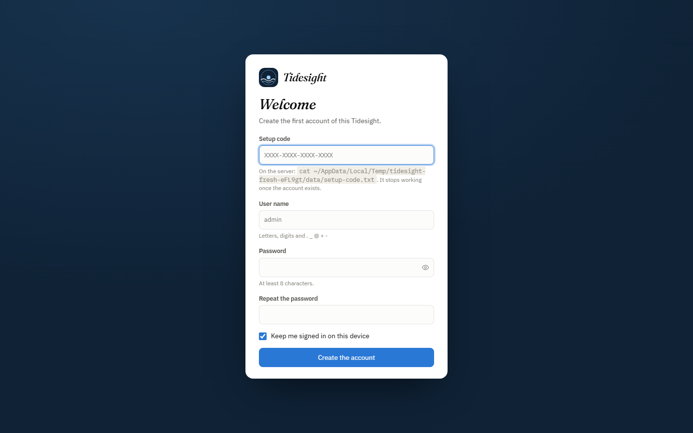

### 4. Add your website

Properties → **Add property**: the website's address and time zone, what to record, and the line to paste into the `<head>` of its pages. The dialog turns green when the first visit arrives.

```html
<script async src="https://stats.example.com/ts.js" data-site="example-com"></script>
```

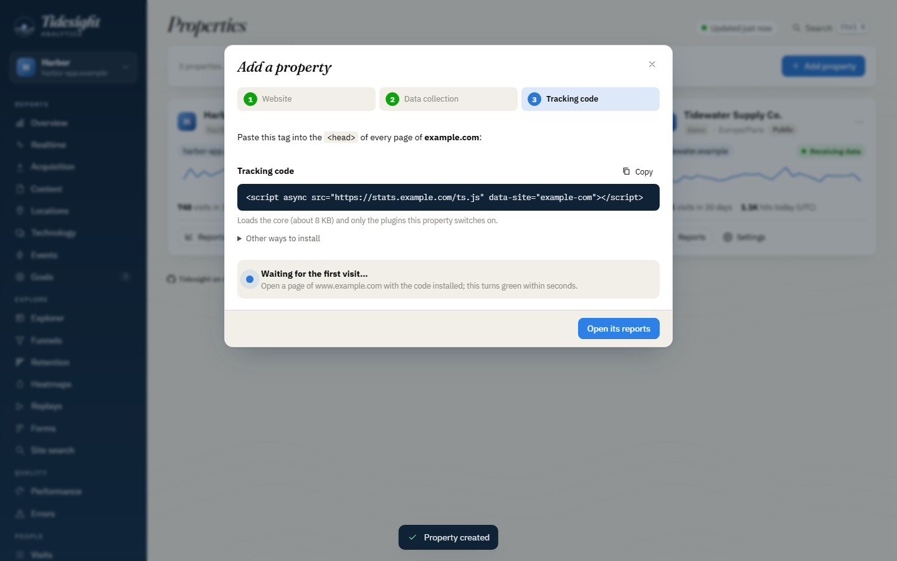

Custom events and known users take one more line each:

```js
tidesight('track', 'signup', { plan: 'pro' });   // custom event
tidesight('identify', 'user-42');                 // known user
tidesight('ignore');                              // run once in your own browser to exclude it
```

Every command, the page markup (error pages, masking, elements to leave out), single-page apps, Content Security Policy and the no-JavaScript pixel are in [`docs/tracker.md`](docs/tracker.md); switching features per site, in [`docs/configuration.md`](docs/configuration.md).

### 5. Watch the tide come in

Visitors appear on the Realtime page within seconds; reports fill in as the cron job runs, every couple of minutes.

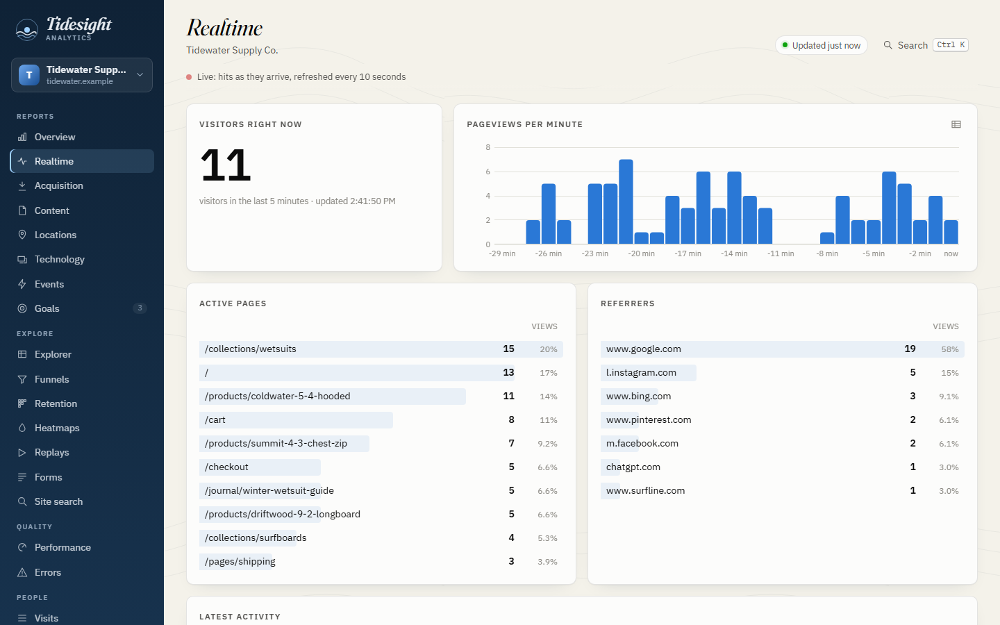

### 6. See what people searched for

Connect Google Search Console and Bing Webmaster Tools once (free, about ten minutes, step by step in the property's **Search engines** settings: [`docs/search-engines.md`](docs/search-engines.md)), and the **Search engines** report shows the queries that bring visitors, with clicks, impressions and positions, next to the visits, bounce rate and conversions of each landing page.

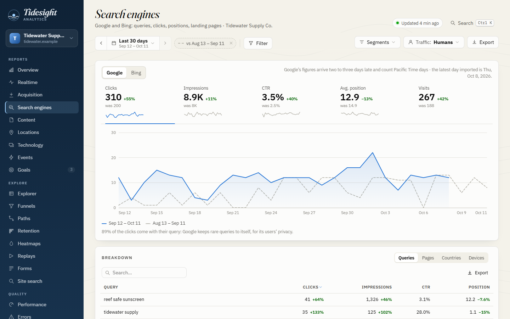

### 7. Invite your team, stay up to date

Admins invite people from the **Users** page with one-time links (no email involved) and choose their role: admin or viewer. Once a day Tidesight looks for a new release; an admin clicks **Update**, and the next cron run downloads it, checks it, puts it in place and keeps the previous version for a rollback. The tracking code on your sites never changes: `ts.js` is served by Tidesight, so it follows.

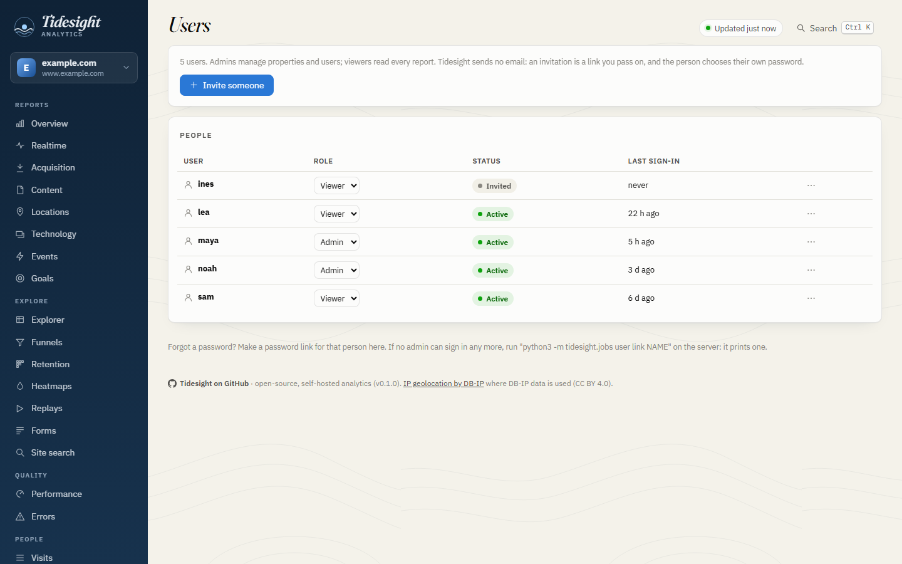

## The dashboard

Overview, realtime, acquisition (channels, sources, mediums, campaigns, referrers), search engines (Google Search Console and Bing Webmaster Tools: queries, clicks, impressions, positions, landing pages), content (pages, entry and exit pages, titles, error pages), locations, technology, events and their properties, goals and conversions, an explorer for any dimension, funnels, paths (a flow of the visits' pages, and what comes before and after a page), retention cohorts, heatmaps (clicks, rage and dead clicks, mouse, scroll reach), replays, forms, site search, Web Vitals, errors, visits with a timeline, visitor profiles, properties, people and a status page.

- **Analysis as in the big tools:** compare any period with the previous one, the same days a year before or any range (dashed in charts, changes everywhere); filter every report by any dimension with `is`, `is not`, `contains`, `does not contain`, `starts with`, or with a click on a row; save filters as segments; mark days with annotations; set goals and see their conversions in every report.
- **Report tables** with server-side sort, search and paging, totals and shares, a second dimension, a column chooser, row actions, up to five rows plotted over time, and every matching row exported to Excel, CSV, TSV or JSON. An export dialog says exactly what each download holds, raw datasets included.
- **Properties managed in the dashboard:** add a site (domains, name, time zone, what to record) and get its tracking code with a live check of the first hit; change its settings, goals, privacy and public page; delete it with or without its data.
- **People managed in the dashboard:** the first account with a setup code read on the server; then invitations as one-time links, roles (admin or viewer), password links for forgotten passwords.
- Sign-in page, a command palette (Ctrl/⌘ K) and keyboard shortcuts, a freshness indicator, light and dark themes, a table twin for every chart, optional public share pages. Everything it shows comes from a [JSON API](docs/api.md).

<table>
  <tr>
    <td width="50%">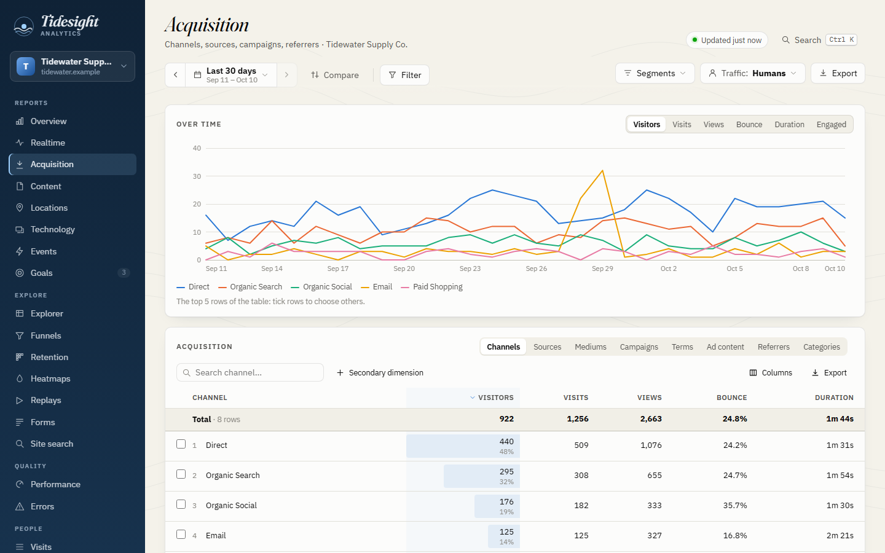</td>
    <td width="50%"></td>
  </tr>
  <tr><td align="center">Reports and comparisons</td><td align="center">Filters on any dimension</td></tr>
  <tr>
    <td width="50%"></td>
    <td width="50%">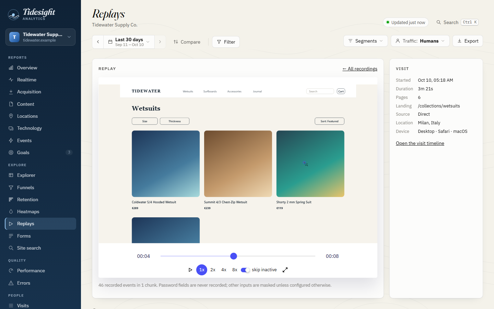</td>
  </tr>
  <tr><td align="center">Heatmaps</td><td align="center">Session replay</td></tr>
  <tr>
    <td width="50%"></td>
    <td width="50%">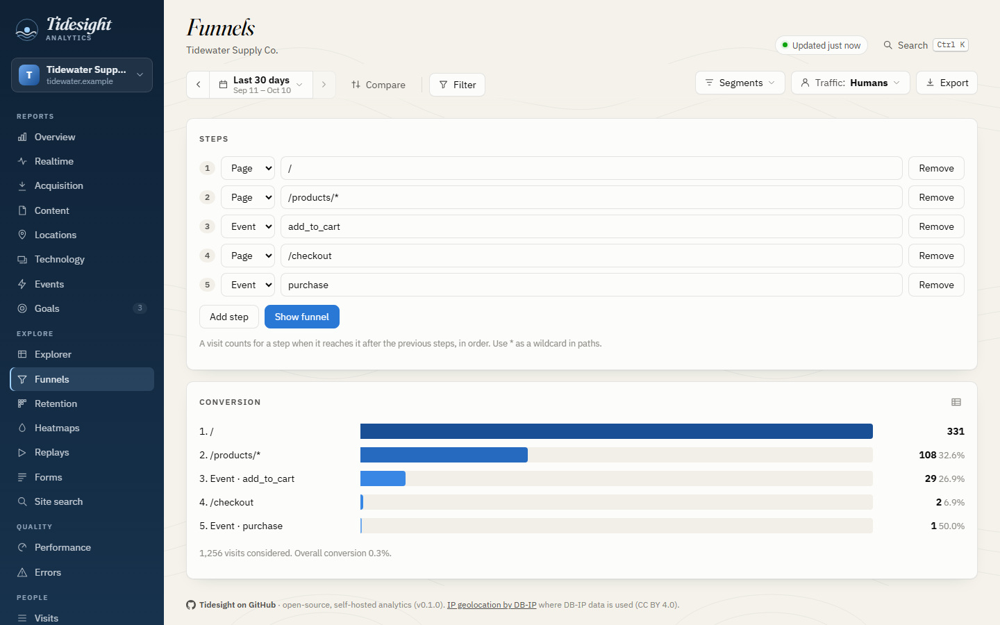</td>
  </tr>
  <tr><td align="center">Visit timeline</td><td align="center">Funnels</td></tr>
  <tr>
    <td width="50%">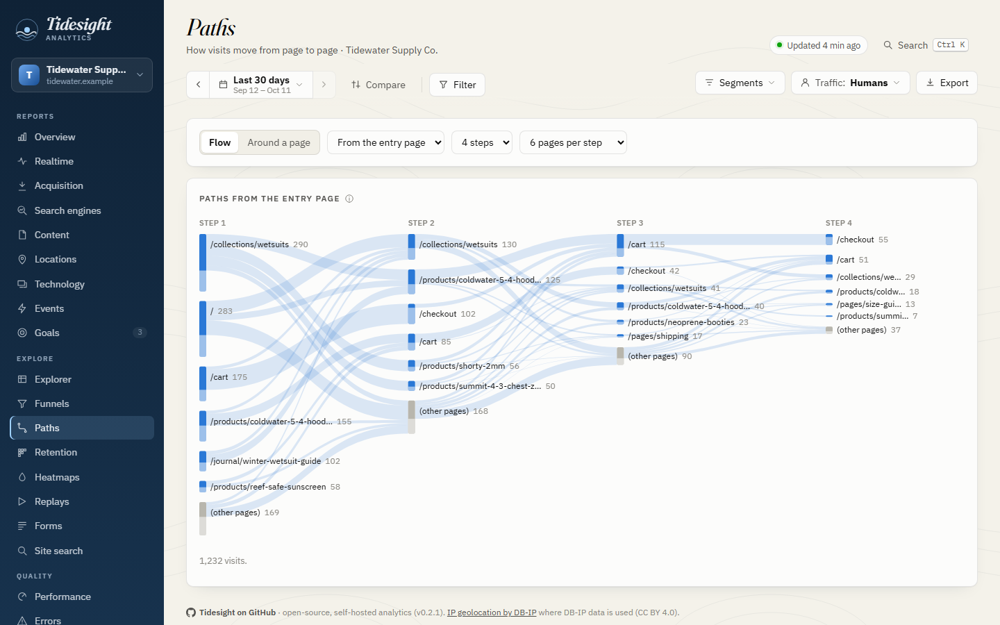</td>
    <td width="50%">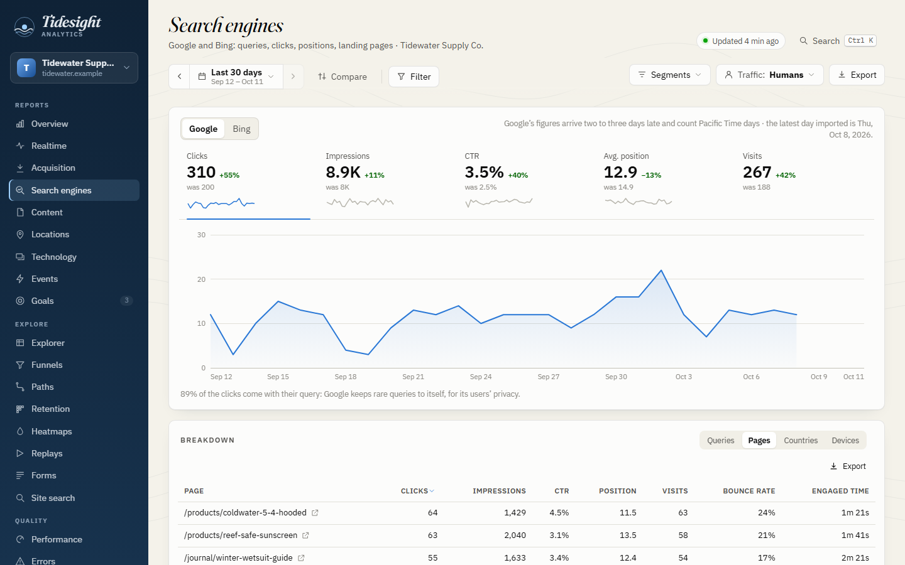</td>
  </tr>
  <tr><td align="center">Paths</td><td align="center">Search engines and landing pages</td></tr>
  <tr>
    <td width="50%">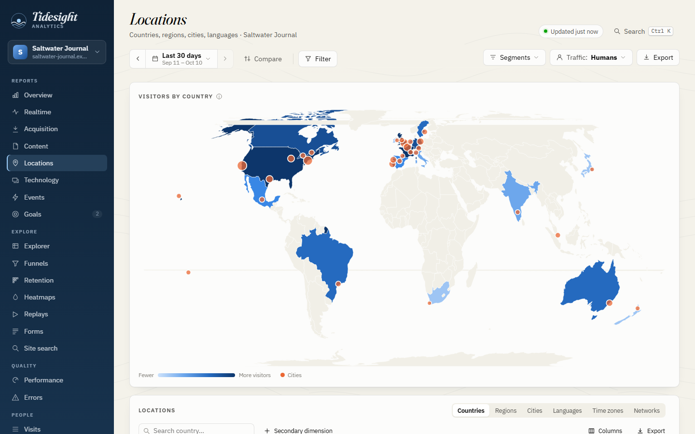</td>
    <td width="50%">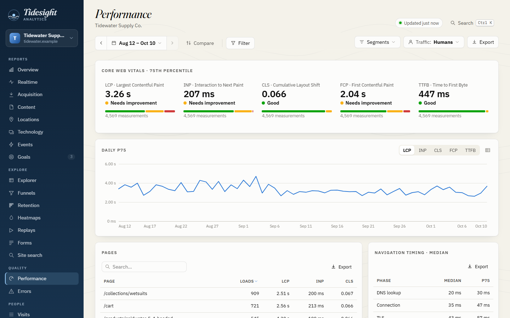</td>
  </tr>
  <tr><td align="center">Locations</td><td align="center">Web Vitals</td></tr>
</table>

## What it records

| | |
|---|---|
| **Traffic** | Pageviews with full context (referrer, UTM and click ids, screen, language, time zone, high-entropy Client Hints), SPA route changes (History API and `#hash` routes), custom events with properties, user ids, 404 pages, site search. |
| **Visitors** | A persistent visitor id (first-party cookie + localStorage, optionally a server-set cookie), sessions with idle timeout, engaged time (visible, focused, not idle), new vs returning, identity stitching across devices and ids. |
| **Behaviour** | Clicks with element-relative heatmap positions, rage, dead and error clicks, outbound links and downloads, scroll depth, form analytics (timings and abandonment, never values), mouse movement, copy and selection, ad-blocker detection. |
| **Quality** | Web Vitals (LCP, INP, CLS, FCP, TTFB), Navigation Timing, long tasks, JavaScript and resource errors (de-duplicated). |
| **Replay** | Session recordings with [rrweb](https://github.com/rrweb-io/rrweb) (sampled, passwords never recorded, inputs masked by default) and DOM snapshots that keep heatmaps accurate when layouts change. |
| **Server side** | Raw IP and every request header (credentials and other cookies redacted), the raw payload, receive time and client time. |
| **Derived** | Geolocation (DB-IP Lite, MaxMind GeoLite2 or IPinfo Lite, read by a pure-Python reader), browser, OS and device from the user agent and Client Hints, bot classification, GA4 channel grouping (including AI assistants), a cookieless daily visitor hash, daily rollups. |

Behaviour plugins have a per-site sampling rate. The full catalogue is in [`docs/datapoints.md`](docs/datapoints.md).

## How it works

```
 browser ── ts.js + plugins ──▶ collector (/collect, /chunk, /p.gif)
                                   │  appends raw, flags anything odd, never enriches
                                   ▼
                          events.db  (raw hits)        replay.db  (recordings, mouse, snapshots)
                                   │
                cron: jobs.py enrich, rollup, backup, privacy-clean, …
                                   ▼
                          derived.db  (sessions, pageviews, geo, devices, bots, identity, rollups)
                                   │
                         api.py (JSON) ──▶ dashboard (static, no build step)
```

`derived.db` can be deleted at any time: it is rebuilt from the raw data. Running processes pick new code up by themselves, database migrations run automatically, and when the way data is derived changes, the next enrichment rebuilds it from the raw hits. Details in [`docs/architecture.md`](docs/architecture.md), and the reasoning behind each choice in [`docs/design.md`](docs/design.md).

Besides the Python collector, connectors for **PHP**, **Node** and **Cloudflare Workers (D1)** speak the same protocol and write the same schema, checked by a shared conformance suite ([`docs/connectors.md`](docs/connectors.md)).

## Security and abuse protection

- **The collector is a public endpoint, so it is bounded:** body sizes and gzip expansion are capped. Each client (an IPv4 address or an IPv6 /64) has per-minute allowances for requests and kilobytes, with separate allowances for recordings; once over it, its requests are refused before their body is parsed. Junk traffic (unknown sites, wrong origins, malformed bodies) gets its own small allowance, an optional daily quota per site caps storage, and writes stop with a 503 when disk space runs low ([details](docs/configuration.md#limits-and-abuse-protection)).
- **The tracker cannot flood it either:** it caps its own events and uploads per minute, splits batches under the collector's size limit, and backs off on errors. It trusts nothing on the host page: markup injected into a page cannot redirect it or make it load another script.
- **No secrets are stored:** credentials and other sites' cookies are redacted from headers. Tokens, passwords, session ids and signatures in URLs are replaced by `redacted` before they leave the browser (and in the `Referer` the collector keeps). Form values are never collected, and session replays mask inputs and rich-text editors.
- **The dashboard is protected:** people sign in with a form (PBKDF2 hashes, throttled guessing, an HttpOnly `SameSite=Strict` session cookie whose token is stored only as a hash and ends when the password changes); scripts may use HTTP Basic. Passwords travel over HTTPS only. Every change needs the dashboard's own header and origin, and only admins change properties and people. The pages have a strict Content Security Policy that keeps recordings from contacting other hosts. Public share pages are optional, token-protected, rate-limited, and never show figures for fewer than 3 visitors.
- **Audited:** the collectors, the tracker and the dashboard went through adversarial security reviews, and every finding was fixed and covered by tests ([`docs/roadmap.md`](docs/roadmap.md)). To report a vulnerability, see [`SECURITY.md`](SECURITY.md).

## Development

| Task | Command |
|---|---|
| Python tests | `python -m pytest` |
| Tracker build and browser tests | `cd tracker && npm install && npx playwright install chromium && npm test` |
| Dashboard browser tests | `cd tracker && npm run test:dashboard` (demo data, four local servers) |
| Connector conformance | `TIDESIGHT_CONNECTORS=php python -m pytest server/python/tests/test_conformance.py` |
| Screenshots (`docs/images`) | `python tools/demo.py --out demo-data --public-url https://stats.example.com/` then `node tools/screenshots.mjs --data demo-data` |
| Website and live demo | `cd site && npm ci && cd .. && python tools/build_site.py --out _site` (published by `.github/workflows/pages.yml`) |

Contributors and coding agents: start with [`AGENTS.md`](AGENTS.md) and [`CONTRIBUTING.md`](CONTRIBUTING.md).

## Documentation

- [Design principles and decisions](docs/design.md)
- [Architecture](docs/architecture.md)
- [Using the tracker](docs/tracker.md)
- [Dashboard API](docs/api.md)
- [Wire protocol](docs/protocol.md)
- [Database schema](docs/schema.md)
- [Data-point catalogue](docs/datapoints.md)
- [Configuration](docs/configuration.md)
- [Deploying on Dreamhost](docs/deploy-dreamhost.md)
- [Search engines: Google Search Console and Bing](docs/search-engines.md)
- [Privacy mode and clean-up jobs](docs/privacy.md)
- [Connectors and writing a new one](docs/connectors.md)
- [Roadmap](docs/roadmap.md)

## Status

Every phase of the plan is built and tested: collector, tracker, enrichment, behaviour plugins, session replay, dashboard and API, people and updates, privacy mode and maintenance jobs, and the PHP, Node and Worker connectors. It runs in production on Dreamhost shared hosting (FastCGI, SQLite with WAL, everything in one folder). Still open: trying the PHP and Worker connectors on live hosts. See [`docs/roadmap.md`](docs/roadmap.md).

## Licence

MIT, see [`LICENSE`](LICENSE). Vendored third-party code keeps its own licence: rrweb and rrweb-player (MIT), the Fraunces and IBM Plex fonts (SIL OFL 1.1), country outlines from Natural Earth via world-atlas (ISC), and the GitHub mark from Octicons (MIT). Geolocation databases are downloaded by the `geo-update` job, never bundled; DB-IP Lite data requires attribution (CC BY 4.0), which the dashboard shows. The website's live demo runs on [Pyodide](https://github.com/pyodide/pyodide) (MPL 2.0), fetched when the website is built.
